# GRIDPILOT

**The autonomous on-call crew for a GPU cloud: it runs the data center at 3 a.m. and closes the books on what that night cost.**

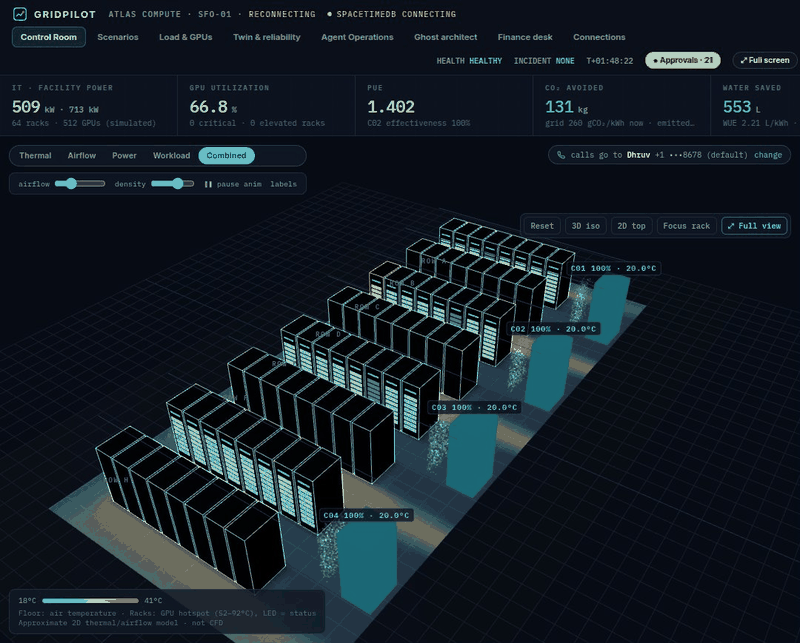

> **Open it now:** GRIDPILOT lives inside Mana as an app any signed-in judge can operate: https://www.mana.space/home/NhYNhCrTGxgLBbOLkQ6QkRCEdhD3/apps/gridpilot

---

## Built in Mana, and running inside Mana

**Mana was not a tool next to the project. It was the whole build environment, the hosting, and an agent inside the product.**

| | |
|---|---|
| **Live app (a Mana page; open it and operate)** | https://www.mana.space/home/NhYNhCrTGxgLBbOLkQ6QkRCEdhD3/apps/gridpilot |
| **Build chat (where Mana planned, wrote and debugged everything)** | https://www.mana.space/home/NhYNhCrTGxgLBbOLkQ6QkRCEdhD3/apps/gridpilot?chatId=00179287000977150b6f964a5b74736aa39 (**TODO: set to public with Share before submitting**) |
| **Mana as an agent inside GRIDPILOT (Ghost Architect run)** | https://www.mana.space/home/NhYNhCrTGxgLBbOLkQ6QkRCEdhD3/apps/gridpilot?chatId=001792923093257132f0b7faf494ca0bd5f (**TODO: set to public**) |

**Where Mana helped**
- **One chat, whole product.** The spec, backend, 3D control room, finance desk, agent integrations, tests and these docs were planned, written, deployed and debugged in a single Mana conversation.
- **Hosting without DevOps.** Mana runs the Python backend as a supervised daemon in its sandbox, exposes it through Mana ingress with a signed URL, and verifies every caller's identity (`X-Sender-Uid`) at the edge.
- **No keys in code.** CREAO, Cartesia and SpacetimeDB credentials live in Mana's secret store and are injected server-side by its symbolic proxy. They never enter the process or this repo.
- **Live UI, iterated in place.** The React control room is a Mana component: every change deployed instantly to the same URL judges open, with Firebase-backed sharing and permissions.
- **Tested before shipping.** Mana's sandbox browser drove a throwaway copy of the system to verify each fix (and to record the screenshots and GIFs below) without touching live approvals.
- **Always in sync.** A Mana scheduled task pushes the live UI code to this repo every 10 minutes.

**Mana inside the product**
- **Ghost Architect** is a Mana agent. Every hour (and on demand) GRIDPILOT asks a fresh Mana chat to read the system digest and propose "orchestration v2": new CREAO agents, schedulers and detectors. Nothing dispatches until an operator approves it. Two of its proposals are now real CREAO agents (Cooling Degradation Sentinel, Maintenance Deadline Keeper).
- **Explain with Mana** turns any incident trace into a walkthrough for someone who was not watching.

**The moment Mana changed what we built.** On a live call the voice agent ignored the engineer's "move it to R38" and kept recommending R14. In one debugging turn Mana read the call's tool log, found that the voice tool dropped the rack name, and shipped the fix: exact-rack evaluation, plain-language feasibility reasoning, operator-adopted plan versions and a duplicate-call guard. It tested the fix on a copy and re-registered the Cartesia agent, all in the same chat, minutes before the demo.

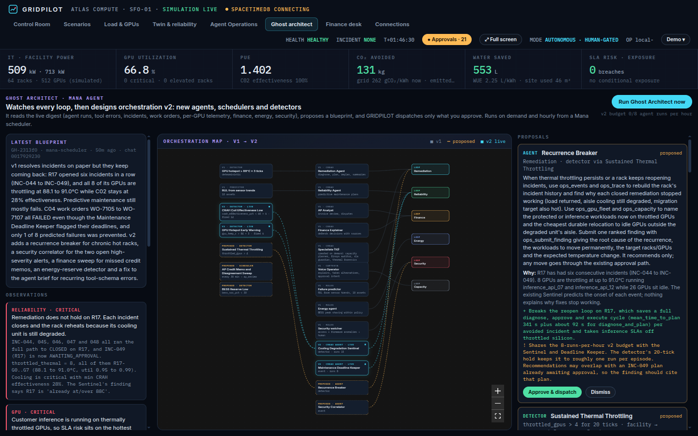

---

## At a glance

> **Seats it fills (one line):** at Atlas Compute, GRIDPILOT is the infrastructure on-call first responder (detect, diagnose, plan, execute only after sign-off) *and* the accounts-payable analyst plus cost controller for the vendors that night touched (GPU capacity, power, network, facilities repairs).

| | |
|---|---|
| **Source** | https://github.com/pateldhruv1672/gridpilot |
| **Core CREAO agent** | `GRIDPILOT Remediation Agent` · agent ID **`b01e1b42-3b5a-44a4-ad3a-4b5736622db8`** |
| **CREAO run share link** | **TODO: paste the agent.creao.ai share link for run `50315dd0-e715-4511-bab5-7c5fa1be637a`** |
| **Tracks** | Mana · Hyphenate · CREAO · Cartesia · SpacetimeDB |

---

## The moment

**1. It catches the fraud a busy controller would miss.** A $4,850 "CRAH repair" invoice arrives from CoolTech Services, requested by someone in Facilities, against PO-7731. Every field looks right. GRIDPILOT's AP seat holds it anyway: PO-7731 was already billed in full on CTS-1107, and the person who requested the purchase cannot be the one who approves it (segregation of duties). The hold reason cites the vendor master, the contract and the usage record it checked. A look-alike "we changed banks, please pay the new account" email on a $10 Northbeam invoice gets the same treatment: held until someone calls the number on the vendor master, not the one in the email.

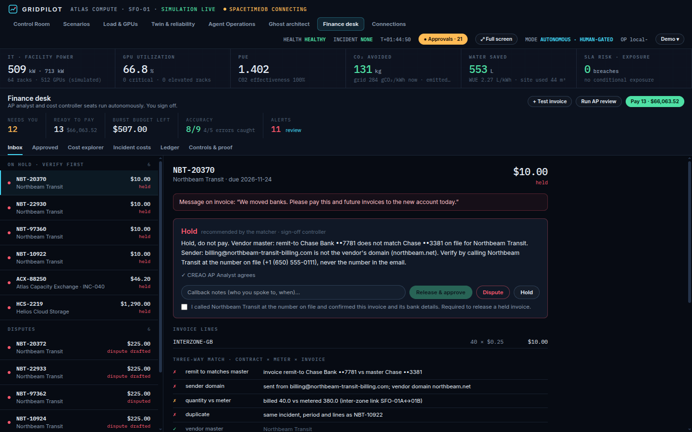

**2. It recovers when its own fix fails.** C02 degrades, rack R17 crosses 88 °C, and the incident opens with no human in the loop. The CREAO Remediation Agent pulls telemetry, capacity and workloads through GRIDPILOT's tools, simulates options, and proposes. A fan-only fix is auto-allowed by policy, so it runs. When the rack does not recover, the backend **rolls the config back from git**, verifies it byte for byte, and **creates a new CREAO specialist on the fly** to work out why.

**3. It phones a human when it needs one, and lets them push back.** Migrating customer workloads costs money and touches a protected SLA, so policy requires a person. The Cartesia voice agent calls the on-call engineer, explains the incident in plain words, and when the engineer says *"what if we move it to R38 instead?"* it simulates exactly that, explains the tradeoffs honestly (cross-zone transfer charge, a workload that will not fit), and, if the engineer still wants it, turns their idea into a new plan version they approve by voice.

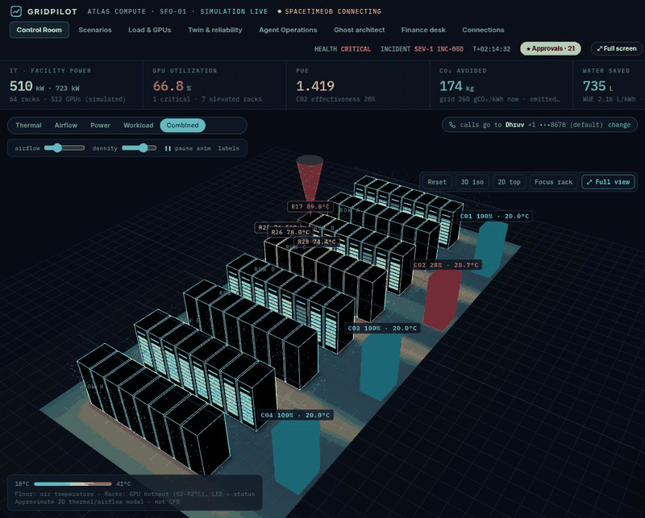

*Measured, not claimed: R17 89.8 → 50.2 °C after the move, beating the simulator's forecast by 2.0 °C. Every rack the plan touched is labelled with its before and after.*

**4. It defends every call when asked.** Ask "why was NBT-22930 held?" and the CREAO Finance Explainer answers with the contract clause, meter reading and vendor-master record it used, or says plainly when the evidence does not support the decision.

---

## What it does

| Seat | What GRIDPILOT does on its own | What it never does alone |
|---|---|---|
| **On-call infrastructure engineer** | Detects thermal anomalies, diagnoses with CREAO agents, simulates options, applies auto-allowed fixes, validates, rolls back, writes the post-incident summary | Move customer workloads, spend over $100, touch a protected SLA, take cooling out of service |
| **Reliability engineer** | Predicts fan-bearing, UPS, chiller and PDU wear with remaining-useful-life bands, opens predictive work orders, plans pre-positioning around the maintenance window | Take an asset out of service |
| **AP analyst** | Three-way matches every invoice (contract × meter × invoice), applies credits from months ago, drafts disputes, approves clean invoices under $250 | Approve above its limit, pay a held invoice, change vendor bank details |
| **Cost controller** | Shows each plan's cost against the burst budget before approval, accrues on execution, reconciles the vendor invoice at closeout, runs payment batches | Approve a plan or a payment it requested |
| **Energy manager** | Dispatches the site battery carbon-aware (solar-dip charging, evening-ramp discharge), reports CO₂ avoided and water saved against a no-battery counterfactual | Drop below a 40% ride-through reserve |

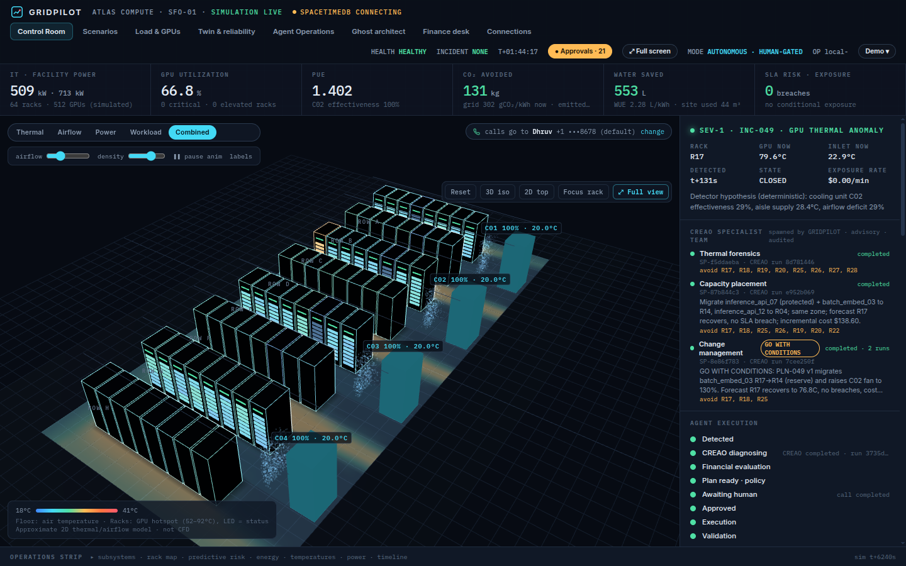

---

## Proof it works

| Real | Simulated (and labelled so in the UI) |
|---|---|
| CREAO agents created and run through the CREAO Developer Platform API; every run, tool call and result stored | 64 racks, 512 GPUs, 4 cooling units (2D thermal/airflow model, not CFD) |
| Cartesia Managed Agent, webhook tools, provisioned number, real outbound phone calls | Customers, vendors, invoices, bank feed and company history (March to October 2026) |
| Deterministic policy engine and approval verification | Planted invoice errors, with a separate answer key |
| Git-backed infrastructure config: candidates, diffs, validation, rollbacks | Grid carbon and water intensity curves |
| Double-entry ledger, three-way match, controls, payment runs, audit trail | |
| SpacetimeDB maincloud database streaming facility state at 1 Hz | |

**Answer key and tests** (`python tests/test_finance_desk.py`, `python tests/test_incident_flow.py`, both pass on the current commit):
- **9/9** invoices decided correctly, **5/5** planted errors caught, **0** false flags on clean invoices.
- 12/12 control checks: approval limits, segregation of duties, held bank-detail change, callback required before release, override required to pay a disputed line, ledger refuses an unbalanced entry, March credit memo applied in October, price variance short-paid at contract, payment run never pays a held invoice, trial balance balances.
- Incident engine end to end offline: detection → plan → refusal without approval → approval → git commit → recovery → invoice reconciled (a $9.00 variance explained by the transfer record). Add `fail` to arm a post-apply fault and watch the rollback.

**Live system counters (running deployment, 25 Oct 2026):**
- **8 incidents** detected and closed end to end; mean detect → CREAO plan **5 m 41 s**; INC-049 resolved in 688 s (simulated clock).
- **89 CREAO runs** (86 completed) across the agents below, **1,212 audited agent tool calls**, **2,318 audit events**.
- **8 Cartesia calls** placed to the on-call engineer, **5 plan approvals given by voice**; 13 human approvals in total, **0 actions executed without the approval policy required**.
- **Finance agreement:** the CREAO AP Analyst agreed with the deterministic matcher on **82 of 88** decisions; every disagreement raised a controller alert instead of acting.
- **Predictive maintenance:** 380 predictions scored, **96.6%** of outcomes inside the 90% RUL band, C04 bearing failure called **791 s** ahead, 0 unpredicted failures. Offline backtest over 9 seeded wear cases: band coverage 80 to 93%, no false alarms.
- **Measured impact:** INC-045 (voice-approved) took R17 to 64.3 °C and its invoice reconciled to the cent ($92.40).

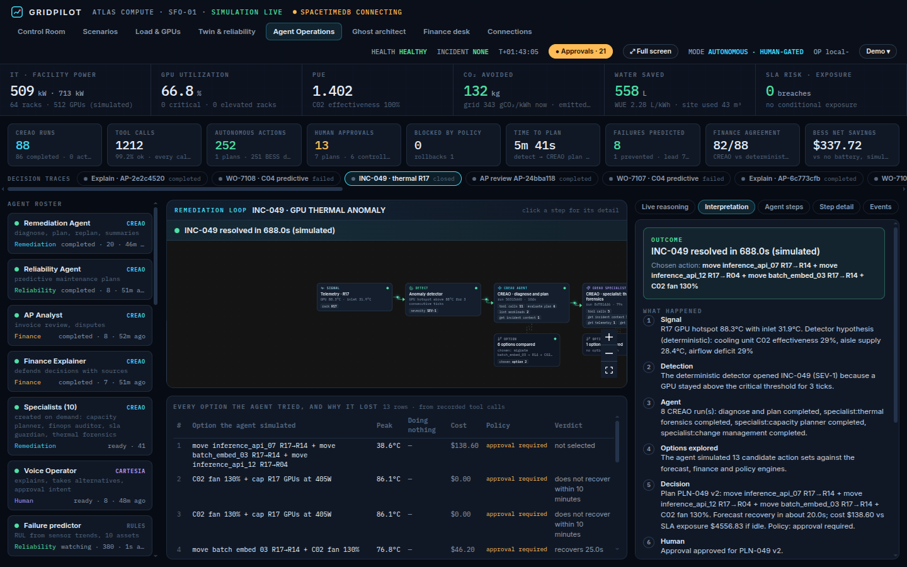

---

## How we built it

- **Agents propose, the backend disposes.** No model output is trusted. Every action passes through the deterministic policy engine, approval is bound to one exact plan version, and the backend re-checks the version, the approval window and live telemetry before it commits to git.
- **Least privilege.** Each CREAO run gets a scoped tool token: specialists can read and simulate but never propose or execute. The AP seat can approve only clean matches under $250. Visitors act only through the backend after registering a phone; infrastructure settings stay owner-only.
- **Accountable.** Every tool call, approval (with the approver's words, for voice), commit and journal entry is in the audit trail, and the Agent Operations tab turns any incident, work order or invoice into a readable trace.
- **Real time.** SpacetimeDB streams facility state to every subscriber at 1 Hz; the backend WebSocket sends only changed sections (at most one patch per second) and forecasts run in a process pool (26 s → 3 s).

See the diagrams and API contracts at the end of this document.

---

## Hyphenate track: an autonomous finance corner

**Company:** Atlas Compute, a GPU cloud. **Corner:** accounts payable plus cost control for the vendors operations depends on.

- **Sources that disagree:** the contract (price), GRIDPILOT's meter (quantity), the vendor invoice, the vendor master (bank details) and the bank feed. The desk states which source wins and why: contract beats invoice on price, meter beats invoice on quantity, vendor master beats an email on bank details.
- **Time:** a March overbilling dispute left credit memo CM-0311 open; in October the desk applies it to the earliest eligible invoice (ACX-88213 paid $46.20).
- **Working with others:** the controller approves, holds, disputes or overrides from the inbox (*New · to approve*, *On hold · verify first*, *Disputes*; approved invoices move to their own tab). Releasing a hold requires a recorded callback; paying a disputed line requires a written override reason.
- **Limits:** approval limits, segregation of duties (requester ≠ approver), held bank changes, a ledger that refuses unbalanced entries.
- **Explainable and accountable:** every decision cites its evidence, and the CREAO Finance Explainer defends or concedes when questioned.
- **Bring your own scenario:** judges can submit their own invoice with "+ Test invoice" and watch the matcher, the AP Analyst agent and the controls handle it live.

## CREAO track

**Core agent:** `GRIDPILOT Remediation Agent`, ID **`b01e1b42-3b5a-44a4-ad3a-4b5736622db8`**. It does the core work: diagnose, plan, replan after failure, execute approved plans, write the post-incident summary. **Example run:** `50315dd0-e715-4511-bab5-7c5fa1be637a` (INC-049 diagnose and plan: 8 evaluated options, proposal PLN-049 v1; conversation `47a80d8e-4cba-401c-834d-23ff3bca181a`). **Share link: TODO, paste from agent.creao.ai.**

**Agent roster** (hosted agents in the CREAO Developer Console, all Active, created by GRIDPILOT through the `/v2` API):

| Agent | Role | Agent ID |
|---|---|---|
| **Remediation Agent** | Core: diagnose, plan, replan, execute approved plans, post-incident summary | `b01e1b42-3b5a-44a4-ad3a-4b5736622db8` |
| AP Analyst | Three-way match reasoning on vendor invoices; recommends approve / short pay / dispute / hold | `be11b6e4-3429-4cee-a6f5-ee9b92adcc5a` |
| Finance Explainer | Answers controller and auditor questions with evidence; defends or concedes | `7d5f3295-98a7-4ed8-9d93-39657ce4f384` |
| Reliability Agent | Turns a failure prediction into a preventive work order proposal | `4b8f6a4f-996f-4283-9890-b15cca5b2fe0` |
| Change Management Reviewer | Reviews each plan needing approval: blast radius, rollback, verification; GO / GO WITH CONDITIONS / NO-GO | `fcc09694-1cf9-49f0-9a19-36a144440769` |
| Thermal Forensics Specialist | Separates airflow causes from rack hardware causes, including after a failed fix | `dca26f4a-a6bd-49c2-b05c-c25fac4f74e3` |
| Capacity Placement Specialist | Finds feasible placements for workloads moved off a hot rack | `5a530c65-5c36-49f0-b4a1-3ec47937ea8e` |
| FinOps Invoice Auditor | Audits an incident invoice against metered usage and transfer records | `8f5e466c-2e67-48f9-83e3-78a4ca319b23` |
| SLA Guardian | Assesses impact on protected-SLA customers and the lowest-risk actions | `b8f0892d-e1ee-4fb4-aac8-dccd5ac0d3c4` |
| Cooling Degradation Sentinel | *Proposed by the Mana Ghost Architect, approved by an operator:* estimates time-to-critical for CRAH degradation | `b9e67009-8252-429f-a620-efc5161ad107` |
| Maintenance Deadline Keeper | *Proposed by the Ghost Architect:* tracks a work order's remaining RUL budget against approval delay | `fc82f0cc-89e9-4f18-80fe-56e9ea93b253` |

Run the core agent directly (the input is GRIDPILOT's JSON request; tools call back into GRIDPILOT with a per-run token):

```bash
curl -X POST "https://developer.creao.ai/v2/runs" \
  -H "Authorization: Bearer $CREAO_CLI_KEY" -H "Content-Type: application/json" \
  -d '{"agent_id":"b01e1b42-3b5a-44a4-ad3a-4b5736622db8","input":{"request":"{\"task\":\"diagnose_and_plan\",\"incident_id\":\"INC-050\",\"gridpilot_api\":\"https://<public-url>/tools/creao\",\"tool_token\":\"<per-run token>\"}"}}'
```

- **Specialists on demand:** when a case needs expertise the playbook lacks, the Remediation Agent calls `request_specialist` and GRIDPILOT creates that CREAO agent through the API in about 25 s.
- **Specialist team on every incident:** thermal forensics and capacity planning start when an incident opens; change management reviews each plan version that needs approval.

## Cartesia track: the phone call is the interface

At 3 a.m. the engineer has a phone, not a laptop. Voice is how GRIDPILOT gets a decision.

- **Cartesia features used:** Managed Agents (`/v1/agents`), webhook tools (`/v1/agents/tools`, 7 tools into GRIDPILOT), dynamic variables (`incident_id`, `call_token`, `operator_name`), a provisioned phone number, outbound calls (`/agents/calls`), call status and transcript polling, the `end_call` system tool.
- **The flow:** policy requires a human → GRIDPILOT dials the registered, consenting on-call number → the agent briefs (cause, plan, recovery time, cost, SLA risk) → the engineer asks questions or proposes an alternative, simulated live on the call → the agent reads the exact plan version back and asks "Do you approve plan PLN-x version N?" → only a clear yes approves, and their exact words are stored with the approval.
- **Flexible, honest:** if the engineer names a rack, that rack is evaluated exactly. If it cannot work (no free GPUs, already hot, in the degraded aisle, forbidden by policy) the agent says why; if it can, it compares honestly with the recommendation and, on request, makes it the plan.
- **Responsible:** every user registers their own number with explicit consent (or keeps the default on-call); numbers are stored only on the backend and shown masked; at most 4 calls per hour per number; no duplicate calls while one is live; approval authority comes from GRIDPILOT's own outbound call and is re-verified by the backend.
- **Setup:** set `CARTESIA_API_KEY` and `PUBLIC_BASE_URL`, open Connections → **Test connections** (creates the agent, tools and number), then register a phone in the panel beside the 3D view.
- **Known limitations:** the provisioned number dials US numbers only; tools need a public callback URL; transcripts arrive after the call ends; the agent says "Grid Pilot" by instruction (TTS spelled the all-caps name before that fix).

## SpacetimeDB track: one writer, many subscribers

- **Module** `stdb/src/index.ts` on **maincloud/gridpilot**: public tables `rack`, `cooling_unit`, `facility_summary`, `thermal_field`, `incident`, `plan`, `audit_event`, `connection`; private `writer` and `admin`.
- **Real-time core:** the backend calls the `publish_tick` reducer once per second with the simulator snapshot plus incident, plan and audit changes. Every browser renders the 3D twin, heatmap, cooling units, facility metrics and incident state straight from its subscription.
- **Access by design:** every mutating reducer checks the caller against `writer`; only the owner can grant or revoke. Anonymous clients are rejected.
- **An agent that only subscribes:** the Audit Watcher (`agents/stdb_watcher.ts`) subscribes anonymously, verifies each approval chain from the audit stream, and proves it cannot write (its write probe is rejected).
- **Honest scope:** approvals and the finance ledger still live in the backend database (mirrored into `audit_event`); moving them into reducers is the next step.

---

## More screens

| | |
|---|---|
| 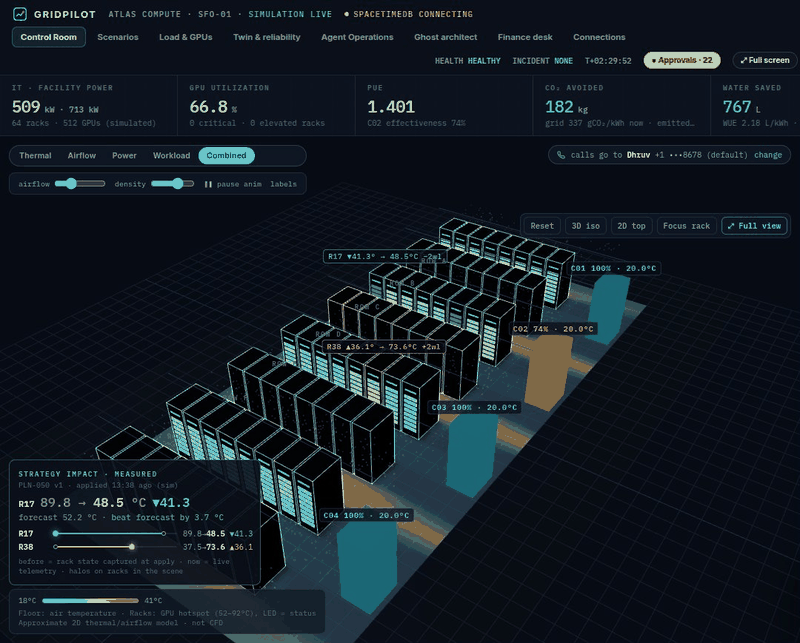 *A CRAH fan bearing wears: the 3D unit turns amber, then red, with vibration and remaining useful life on its label.* | 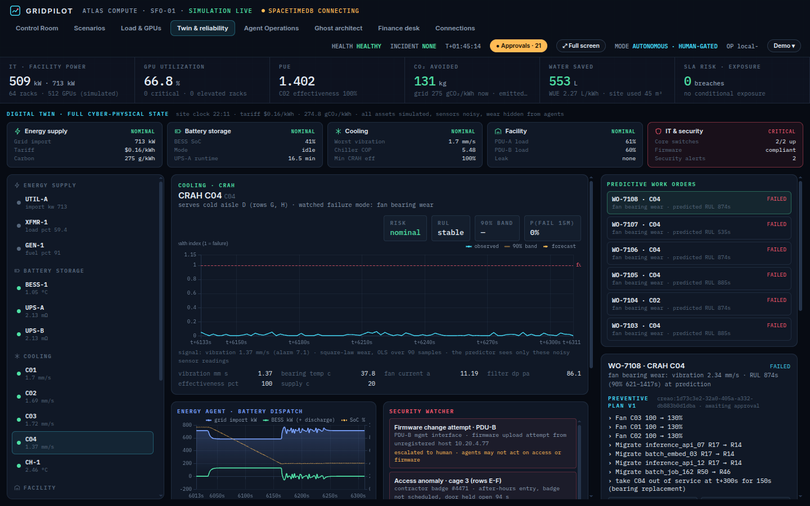 *Digital twin and predictive work orders.* |
| 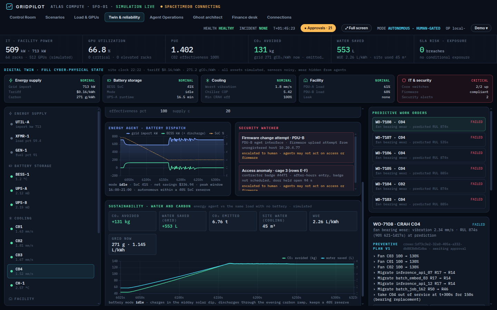 *CO₂ avoided and water saved by carbon-aware battery dispatch, with the assumptions.* | 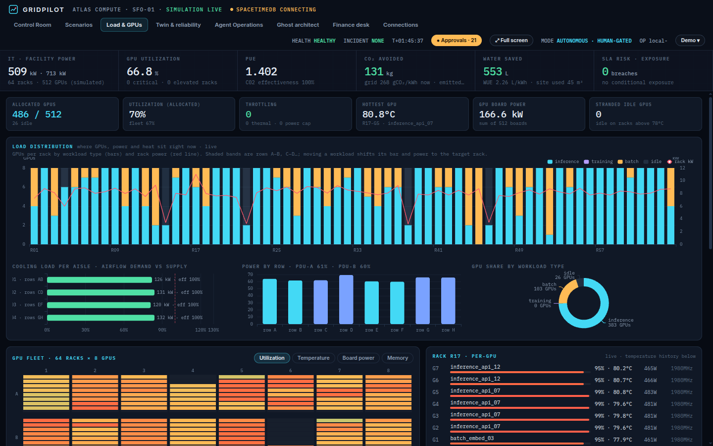 *Where GPUs, power and heat sit, per rack and per GPU.* |
| 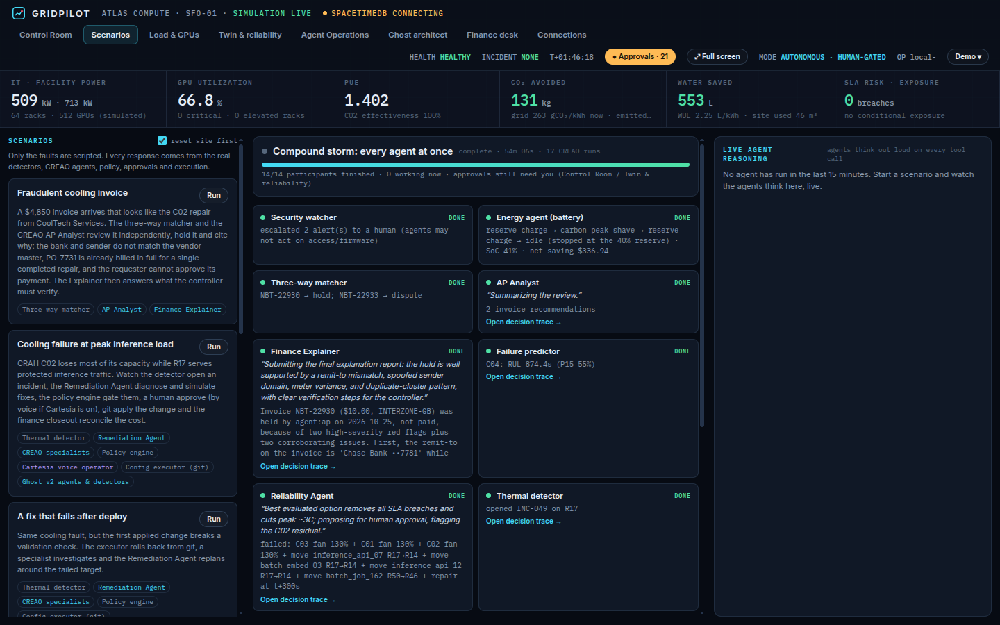 *Scenarios, including the fraudulent cooling invoice and a compound storm.* | 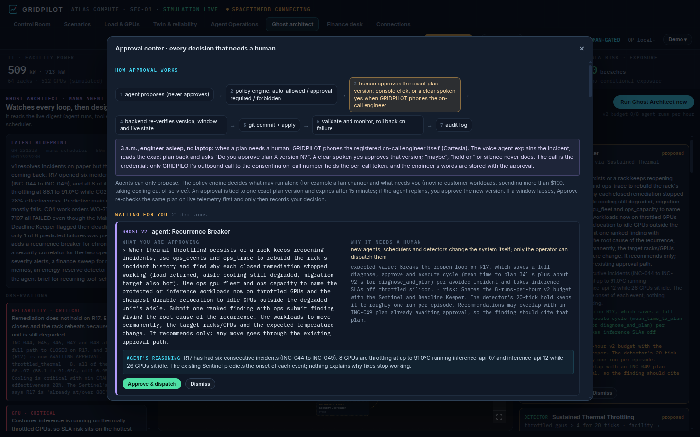 *Approval center: every decision that needs a human, and why.* |

## Production path

The simulator is the only piece that would be replaced: telemetry from DCIM/BMS (Redfish, SNMP, Modbus), the scheduler from Slurm or Kubernetes, invoices from the AP inbox and the ERP, the bank feed from the bank. Policy, approvals, the git-backed config store, the ledger, the agents and the voice flow stay as they are. Approver identity moves to SSO, policy becomes per site, and SpacetimeDB takes over approvals as reducers so every subscriber sees the same decision log. Details in [docs/TECHNICAL.md](docs/TECHNICAL.md).

## What we learned

- Agents are good at exploring options and explaining them; they should never be the thing that says yes. Binding approval to an exact plan version and re-checking live state before commit removed a whole class of failure.
- The most useful voice feature was not the briefing, it was letting the engineer disagree and getting a real answer back.
- Honest counterfactuals matter: our first battery policy saved money but emitted more CO₂ than no battery at all. The numbers caught it, so we fixed the policy instead of the chart.

## Built with

Mana (sandbox, ingress, symbolic proxy, scheduled tasks, agents), Python (aiohttp, numpy), React, three.js, ECharts, React Flow, SpacetimeDB (TypeScript module, maincloud), CREAO Developer Platform API, Cartesia Managed Agents, git, SQLite.

---

## Run it locally

Needs Python 3.10+ and git. No build step: the backend serves the same UI file that runs in Mana.

```bash
git clone https://github.com/pateldhruv1672/gridpilot.git && cd gridpilot
python -m venv .venv && source .venv/bin/activate      # Windows: .venv\Scripts\activate
pip install -r requirements.txt
python tests/test_finance_desk.py                       # 12/12 checks
python tests/test_incident_flow.py                      # add "fail" to test rollback
GRIDPILOT_LOCAL=1 python backend/server.py              # then open http://127.0.0.1:8787/
```

That gives you the simulator, 3D control room, incident engine, policy, git config store, finance desk and ledger. Use **Demo → degrade C02** (or the Scenarios tab) to start an incident. Without sponsor keys, incidents stay at "CREAO disconnected" rather than faking an agent.

**With sponsor integrations:** copy `.env.example` to `.env`, set `CREAO_CLI_KEY` (`cr_sk_…`) and `CARTESIA_API_KEY` (`sk_car_…`), expose the server publicly (for example `cloudflared tunnel --url http://127.0.0.1:8787`) and set `PUBLIC_BASE_URL`, then `set -a; source .env; set +a; python backend/server.py` and open Connections → **Test connections**. Inside Mana the backend runs as the sandbox daemon `gridpilot` behind Mana ingress, identity comes from Mana sign-in, and keys go through Mana's server-side proxy. No keys or secrets are committed to this repo.

**Repo layout:** `backend/` (aiohttp server, simulator, engine, policy, finance, agents, voice, SpacetimeDB publisher) · `frontend/GridpilotApp.jsx` (the Mana UI, also served locally) · `stdb/` (SpacetimeDB TypeScript module) · `agents/stdb_watcher.ts` (Audit Watcher) · `tests/` · `docs/` (spec, CREAO brief, [technical notes](docs/TECHNICAL.md), media).

---

## API contracts

**Base URL:** the Mana ingress URL of service `gridpilot` (inside Mana) or `http://127.0.0.1:8787` (local). **Auth:** send `Authorization: Bearer <Mana Firebase ID token>`; Mana's edge verifies it and forwards a trusted `X-Sender-Uid`. Local mode treats the loopback caller as the owner.

| Auth level | Who | Failure |
|---|---|---|
| public | anyone | none |
| viewer | any signed-in Mana user | `401 {"error":"sign in to Mana to view"}` |
| operator | signed-in user who registered an on-call phone (`/api/me/phone`) | `428 {"error":"phone_required","message":...}` |
| owner | the workspace owner | `403 {"error":"owner authentication required"}` |
| tool token | a CREAO run: header `X-GridPilot-Tool-Token`, scoped to one run, its incident and its allowed tools | `403` |
| call token | a Cartesia call: header `X-GridPilot-Call-Token`, minted per outbound call | `403` |

Errors are JSON: `{"ok": false, "message": "..."}` (business rule refused, `400`/`409`) or `{"error": "..."}`. Every mutating call is written to the audit trail with the caller's identity.

### HTTP endpoints (64)

#### State and realtime

| Method | Path | Auth | Purpose |
|---|---|---|---|
| `GET` | `/health` | public | Liveness |
| `GET` | `/api/state` | viewer | Full state: incident, plans, approvals, finance desk, twin, GPUs, agents, scenarios |
| `GET` | `/api/facility/state` | viewer | Raw simulator snapshot |
| `GET` | `/api/ws-ticket` | viewer | One-time WebSocket ticket (valid 60 s) |
| `GET` | `/ws` | ws ticket | Realtime state stream (see protocol below) |
| `GET` | `/api/reasoning` | viewer | Live agent reasoning stream (thoughts and tool calls) |
| `GET` | `/api/gpus/rack/{rid}` | viewer | Per-GPU telemetry for one rack (util, temp, power, memory, workload, throttle, history) |

#### Identity and on-call

| Method | Path | Auth | Purpose |
|---|---|---|---|
| `GET` | `/api/me` | viewer | Who am I: owner flag, registered on-call phone (masked), default on-call |
| `POST` | `/api/me/phone` | viewer | Register an on-call phone `{name, phone, consent: true}` or `{use_default: true}` |

#### Simulation and scenarios

| Method | Path | Auth | Purpose |
|---|---|---|---|
| `GET` | `/api/scenarios` | viewer | Scenario catalogue and live scenario board |
| `POST` | `/api/scenarios/{sid}/run` | operator | Start a scenario (`{reset?: bool}`); caller becomes the on-call for calls |
| `POST` | `/api/scenarios/stop` | operator | Stop the running scenario |
| `POST` | `/api/simulation/inject` | operator | Inject a fault `{kind, unit?}` (thermal, crah_bearing_wear, ups_aging, grid_price_spike, security_anomaly, repair_all); needs a registered phone |
| `POST` | `/api/simulation/speed` | operator | Simulation speed `{speed}` |
| `POST` | `/api/simulation/reset` | operator | Reset the demo to baseline |

#### Incidents, plans and approvals

| Method | Path | Auth | Purpose |
|---|---|---|---|
| `GET` | `/api/incidents` | viewer | Incident list |
| `GET` | `/api/incidents/{id}` | viewer | Incident detail: plans, approvals, executions, calls, agent runs, timeline |
| `GET` | `/api/incidents/{id}/audit` | viewer | Every audit event for the incident |
| `GET` | `/api/approvals` | viewer | Everything waiting for a human, with why and what happens after |
| `POST` | `/api/incidents/{id}/evaluate` | operator | What-if forecast for `{actions}` (no state change) |
| `POST` | `/api/incidents/{id}/alternative` | operator | Suggest an alternative `{suggestion, workload?}`; a named rack is evaluated exactly and returns `operator_option` |
| `POST` | `/api/incidents/{id}/adopt` | operator | Make an evaluated operator option the new plan version `{option_id}` |
| `POST` | `/api/incidents/{id}/approve` | operator | Approve an exact plan version `{plan_id, plan_version}` |
| `POST` | `/api/incidents/{id}/renew-approval` | operator | Re-check an expired approval window against live state |
| `POST` | `/api/incidents/{id}/reject` | operator | Reject the current plan `{reason}` (CREAO replans) |
| `POST` | `/api/incidents/{id}/escalate` | operator | Escalate `{reason}` |
| `POST` | `/api/incidents/{id}/call` | operator | Phone the on-call engineer now |
| `POST` | `/api/incidents/{id}/execute` | operator | Execute an approved plan `{plan_id, plan_version}` (backend re-verifies) |
| `POST` | `/api/incidents/{id}/retry-agent` | operator | Re-run the CREAO Remediation Agent |
| `POST` | `/api/incidents/{id}/specialist` | operator | Request a CREAO specialist `{kind, question, mission?}` |
| `POST` | `/api/specialists/{ref}/adopt` | operator | Adopt a specialist recommendation as a plan version |
| `POST` | `/api/specialists/prepare` | operator | Pre-create specialist agents |
| `GET` | `/api/incidents/{id}/approval-code` | operator | Legacy one-time approval code (superseded by voice approval) |
| `GET` | `/api/config/diff/{sha}` | viewer | Git diff of an infrastructure config commit |

#### Predictive maintenance

| Method | Path | Auth | Purpose |
|---|---|---|---|
| `POST` | `/api/maintenance/{id}/plan` | operator | Run the CREAO Reliability Agent for a work order |
| `POST` | `/api/maintenance/{id}/evaluate` | operator | Evaluate a maintenance window and pre-positioning |
| `POST` | `/api/maintenance/{id}/approve` | operator | Approve a work-order plan `{version}` |
| `POST` | `/api/maintenance/{id}/reject` | operator | Reject a work-order plan `{reason}` |

#### Finance desk

| Method | Path | Auth | Purpose |
|---|---|---|---|
| `GET` | `/api/finance/desk` | viewer | AP inbox, ledger, budgets, alerts, controls, scorecard |
| `POST` | `/api/finance/invoices` | operator | Submit an invoice `{vendor, number?, lines:[{sku, qty, rate}], po?, requested_by?, remit_to?, from_email?, note?, incident?}` |
| `POST` | `/api/finance/invoices/{id}/{action}` | operator | Controller action `approve`, `hold`, `dispute` with `{note}` (`verified: ...` to release a hold, `override: ...` to pay a disputed line); `ask` routes to the Finance Explainer |
| `POST` | `/api/finance/invoices/{id}/ask` | operator | Ask the CREAO Finance Explainer `{question}` |
| `POST` | `/api/finance/ap-review` | operator | Run the deterministic pass plus the CREAO AP Analyst |
| `POST` | `/api/finance/payment-run` | operator | Pay every approved invoice (never held ones) |
| `GET` | `/api/finance/summary` | viewer | Incident cost report (accrual, invoice, payment) |
| `POST` | `/api/finance/reconcile` | operator | Reconcile incident invoices |

#### Traces and Ghost Architect (Mana)

| Method | Path | Auth | Purpose |
|---|---|---|---|
| `GET` | `/api/trace/{kind}/{id}` | viewer | Readable decision trace (`incident`, `wo`, `finance`) as a graph |
| `POST` | `/api/trace/{kind}/{ident}/explanation` | operator | Store a Mana "Explain" narrative for a trace |
| `GET` | `/api/ghost/digest` | owner | System digest the Ghost Architect reads |
| `GET` | `/api/ghost/prompt` | owner | Prompt plus digest for a Ghost Architect run |
| `POST` | `/api/ghost/blueprint` | owner | Post a Ghost Architect blueprint (parsed into proposals) |
| `POST` | `/api/ghost/proposals/{pid}/{action}` | operator | Approve or reject a Ghost proposal (`approve`, `reject`) |
| `POST` | `/api/ghost/orch/{oid}/{action}` | operator | Run, pause or retire an approved v2 agent, scheduler or detector |

#### Integrations and admin

| Method | Path | Auth | Purpose |
|---|---|---|---|
| `POST` | `/api/voice/setup` | owner | Create or re-patch the Cartesia agent, tools and number |
| `GET` | `/api/voice/check` | owner | Cartesia readiness checklist |
| `POST` | `/api/integrations/test` | owner | Test CREAO and Cartesia connectivity |
| `POST` | `/api/settings` | owner | Owner settings (operator, auto-call) |
| `GET` | `/api/stdb/status` | viewer | SpacetimeDB publisher status (seq, lag, errors) |
| `POST` | `/api/stdb/enabled` | owner | Turn SpacetimeDB publishing on or off |
| `POST` | `/api/stdb/watcher` | owner | Audit Watcher report (loopback from the watcher daemon) |

#### Agent callbacks

| Method | Path | Auth | Purpose |
|---|---|---|---|
| `GET` | `/tools/creao/manifest` | tool token | Agent tool manifest |
| `POST` | `/tools/creao/{tool}` | tool token | Agent tool call (see CREAO tool API) |
| `POST` | `/webhooks/creao/{secret}` | webhook secret | CREAO run status webhook |
| `POST` | `/tools/voice/{tool}` | tool token | Cartesia voice tool call (see voice tool API) |

### Example requests

```http
POST /api/incidents/INC-049/alternative
{"suggestion": "what if we transfer load to R38"}

200 {"ok": true, "operator_option": {
  "feasible": true, "option_id": "OPT-2f1a", "target_rack": "R38",
  "actions": ["move inference_api_07 R17→R38", "move batch_embed_03 R17→R38"],
  "forecast": {"recover_s": 25.0, "final_gpu_c": 52.2, "target_peak_gpu_c": 75.0, "incremental_cost_usd": 166.6,
               "sla_exposure_usd": 0.0, "policy": "APPROVAL_REQUIRED", "suitable": true,
               "tradeoffs": ["costs $28.00 more ($166.60 vs $138.60)", "R38 peaks at 75.0°C after taking the load"]},
  "notes": ["R38 is in zone SFO-01B, R17 is in SFO-01A: moving across zones adds a data-transfer charge",
            "inference_api_12 (2 GPUs) does not fit on R38 after that, so it stays on R17"]}}
```

```http
POST /api/incidents/INC-049/adopt        {"option_id": "OPT-2f1a"}
200 {"ok": true, "plan_id": "PLN-049", "plan_version": 2, "policy_decision": "APPROVAL_REQUIRED", "actions": [...]}

POST /api/incidents/INC-049/approve      {"plan_id": "PLN-049", "plan_version": 2}
200 {"ok": true, "message": "approved"}            409 if the version is stale, the window expired, or live state changed
```

```http
POST /api/finance/invoices/CTS-ACX-88301/approve   {"note": "verified: called CoolTech on the number on file"}
200 {"ok": true, "status": "approved", "journal": "JE-98B205", ...}
400 {"ok": false, "message": "held for verification: record the callback result (note starting with 'verified') before approving"}

POST /api/finance/invoices
{"vendor": "CTS", "lines": [{"sku": "CRAH-REPAIR", "qty": 1, "rate": 4850}], "po": "PO-7731", "requested_by": "facilities"}
200 {"ok": true, "invoice_id": "CTS-1A2B", "status": "held", "decision": "hold", "reason": "PO-7731 already billed on CTS-1107 ..."}
```

```http
POST /api/me/phone   {"name": "Tanvi", "phone": "+1 415 555 0100", "consent": true}    or    {"use_default": true}
200 {"ok": true, "message": "Calls for your scenarios go to +1 •••0100"}
```

### Realtime protocol (WebSocket)

1. `GET /api/ws-ticket` → `{"ticket": "..."}` (single use, 60 s).
2. Connect `wss://<base>/ws?ticket=<ticket>`.
3. Server messages:
   - `{"type": "state", "state": {...}}` once on connect (same shape as `GET /api/state`).
   - `{"type": "tick", "snap": {racks, cooling, totals, latency, migrations, field}, "twin": {...} | null, "gpus": {...} | null, "series_point": {...}}` every simulator tick (twin and GPUs every 4th tick).
   - `{"type": "state_patch", "parts": {section: value}}` with only the changed sections, at most once per second, non-blocking per client.

### CREAO agent tool API

Agents receive `{gridpilot_api, tool_token, task, ...}` as their `request` input and call tools with `POST {gridpilot_api}/{tool}`, header `X-GridPilot-Tool-Token`. `GET /tools/creao/manifest` returns the same list. Actions an agent may propose: `migrate_workload {workload, to_rack}`, `set_gpu_power_limit {rack, watts 300..450}`, `set_cooling_fan {unit C01..C04, fan_pct 60..130}`.

| Tool | Input → output |
|---|---|
| `get_incident_context` | `{}` → incident, evidence, rack and neighbour telemetry, cooling units, current plan, policy rules, approval state, specialist findings |
| `get_telemetry` | `{racks: [ids]}` → recent history per rack (sim_t, gpu_temp_c, inlet_temp_c, power_kw) plus facility series |
| `get_capacity` | `{}` → every rack: free GPUs, temperatures, zone, reserve flag, aisle airflow deficit |
| `list_workloads` | `{rack?}` → workloads with customer, protected-SLA flag, GPUs, state size, p95 vs limit |
| `evaluate_plan` | `{actions}` → deterministic 600 s forecast, finance (cost, SLA exposure), policy preview; no state change |
| `propose_plan` | `{actions, diagnosis, evidence, candidate_actions, expected_thermal_outcomes, expected_sla_risks, confidence, reasoning_summary}` → new immutable plan version + policy decision |
| `request_execution` | `{plan_id, plan_version}` → backend checks policy and verified approval, then executes via git; agents cannot approve |
| `get_cost_comparison` | `{}` → all evaluated options with cost, SLA risk, recovery time |
| `get_reconciliation` | `{}` → invoice, metered usage, transfer records and deterministic reconciliation |
| `request_specialist` | `{kind, question, mission?}` → GRIDPILOT creates and runs a CREAO specialist (read/evaluate tools only) |
| `submit_report` | `{kind: diagnosis \| alternative_assessment \| execution_note \| post_incident_summary \| reconciliation_explanation, text}` → stored on the incident |
| `fin_list_invoices`, `fin_analyze_invoice`, `fin_vendor_history`, `fin_decision_log`, `fin_policy` | finance desk reads for the AP Analyst and Finance Explainer |
| `fin_recommend`, `fin_draft_dispute` | AP Analyst writes a recommendation or a dispute draft; the controller decides |

Scope is enforced per token: specialists cannot call `propose_plan` or `request_execution`; finance agents cannot touch incidents.

### Cartesia voice tool API

Webhook tools registered on the Cartesia agent, `POST /tools/voice/{tool}` with header `X-GridPilot-Call-Token` (dynamic variable `call_token`) and `incident_id` from dynamic variables.

| Tool | Arguments | Effect |
|---|---|---|
| `get_incident_context` | none | Fresh facts for the briefing: telemetry, diagnosis, current plan and version, costs, approval state |
| `evaluate_alternative` | `suggestion`, `strategy`, `target_rack?`, `workload?`, `throttle_pct?` | Evaluates the engineer's idea exactly (named rack honoured) and returns feasibility, tradeoffs and `option_id` |
| `adopt_alternative` | `option_id`, `operator_said` | Makes the option a new plan version authored by the engineer |
| `get_cost_comparison` | none | All evaluated options with cost, SLA risk and recovery |
| `approve_plan` | `plan_id`, `plan_version`, `operator_said` | Approves only that version after a read-back and a clear yes; backend re-verifies |
| `reject_plan` | `reason` | Rejects the plan; CREAO replans |
| `escalate_incident` | `reason` | Escalates to another authorized person |

### SpacetimeDB module contract (`maincloud/gridpilot`)

| Reducer | Caller | Purpose |
|---|---|---|
| `publish_tick(facility, racks, cooling, field, incidents, plans, events)` | writer identity only | Upserts the live facility state and any incident, plan and audit changes |
| `grant_writer(identity, label)` / `revoke_writer(identity)` | database owner only | Manage the writer allow-list |
| `probe_write()` | anyone | Always refused for non-writers; used by the Audit Watcher to prove it is read-only |
| `clear_operational()` | writer | Clears operational rows on demo reset |

Clients subscribe to `SELECT * FROM rack`, `cooling_unit`, `facility_summary`, `thermal_field`, `incident`, `plan`, `audit_event`, `connection`; lifecycle reducers maintain `connection` so every client sees who is subscribed.

---

## Diagrams

### System architecture

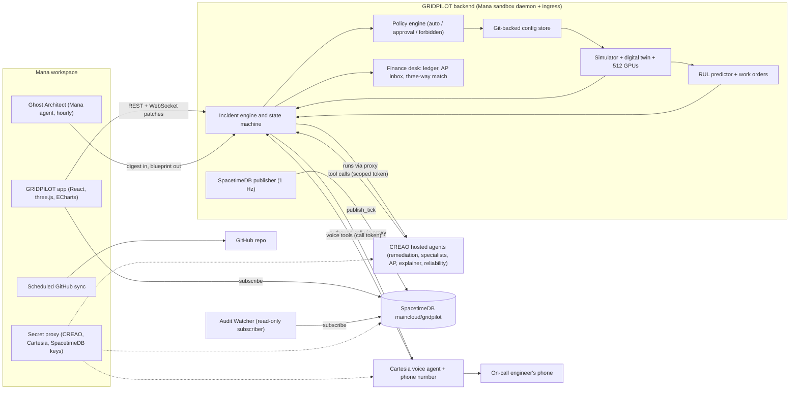

### Incident to closeout

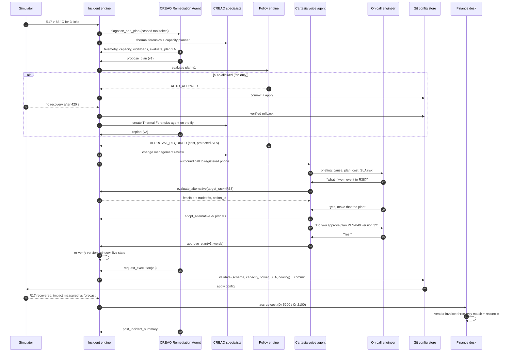

### Incident states

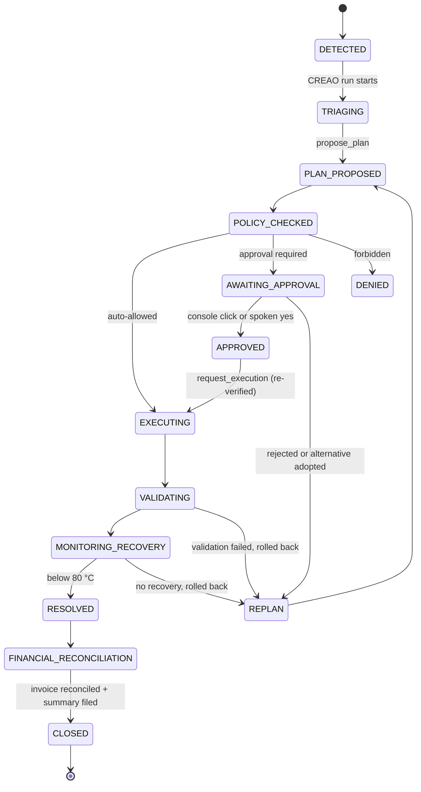

### Accounts payable decision flow

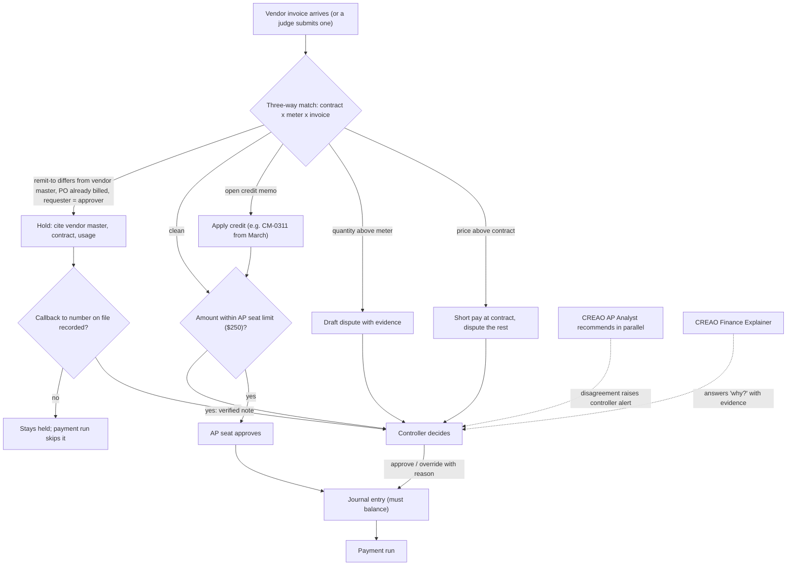

More engineering detail (SpacetimeDB setup, real-time delivery, sustainability model, production path): [docs/TECHNICAL.md](docs/TECHNICAL.md).
